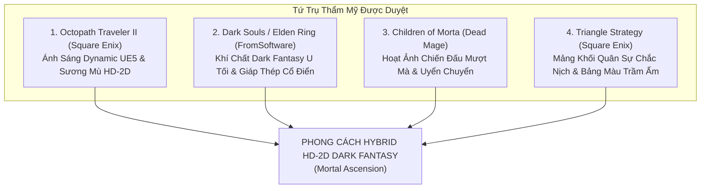

# Bảng Định Hướng Thẩm Mỹ & Tâm Trạng Nhân Vật (Vanguard Mood Board)
## Mortal Ascension — Giai Đoạn 2: Chốt Phong Cách Nhân Vật

> **Dự án**: Mortal Ascension (2.5D Isometric HD-2D Dark Fantasy Action RPG / MMO)  
> **Chủ đề nhân vật**: Tiền Tuyến Sắt Đá — Tiên Phong (Vanguard "Iron Bastion")  
> **Bộ vũ khí & trang bị**: Kiếm Bản Rộng (Broadsword) & Đại Khiên Thép Vuông (Square Tower Shield)  
> **Hợp đồng quy chuẩn**: `SPEC-ART-2026-09-23-V2` (Mục 5.3)  
> **Cơ sở phê duyệt**: Quyết định lựa chọn của Chủ dự án (2026-11-10) theo `ROADMAP.md:66`

---

## 1. Tứ Trụ Game Tham Chiếu Thẩm Mỹ (The 4 Benchmarks)

Chủ dự án đã chính thức lựa chọn 4 tựa game đỉnh cao làm tham chiếu cốt lõi để định hình ngôn ngữ đồ họa của *Mortal Ascension*:



### 1.1 Octopath Traveler II — Đỉnh Cao Chiếu Sáng & Không Gian HD-2D
- **Giá trị cốt lõi tiếp thu**: Tích hợp pixel art vào môi trường 3D với hệ thống ánh sáng động (Unreal Engine Lumen). 
- **Ứng dụng cụ thể**:
  - Hạt pixel có mật độ đồng nhất (Pixels Per Unit = 1.0, Pixel Scale cố định), không mixels.
  - Sprite nhân vật đón nhận ánh sáng thực từ ngọn đuốc, đốm lửa ma thuật và ánh trăng lạnh, tạo bóng đổ xiên chân thực trên nền đất đá cổ kính.
  - Sương mù thể tích (Volumetric Fog) và bụi than le lói tôn vinh silhouette nhân vật.

### 1.2 Dark Souls / Elden Ring — Linh Hồn Dark Fantasy & Sự Phong Trần
- **Giá trị cốt lõi tiếp thu**: Không khí u tối, sự khắc nghiệt của thế giới hoang tàn, trang bị toát lên vẻ thực chiến và phong trần.
- **Ứng dụng cụ thể**:
  - Loại bỏ hoàn toàn họa tiết hoa văn sến súa, ren ren hay viền vàng kiểu fantasy rẻ tiền ("No AI Greeble").
  - Giáp trụ là thép rèn đen gỉ nhẹ, vết xước kiếm sau trăm trận chiến, khiên sắt vuông có vết mẻ thực chiến.
  - Vạt áo tabard màu xanh chàm/chàm đậm rách mép gấu áo, dây nịt da thú sờn màu.

### 1.3 Children of Morta — Động Lực Học Hoạt Ảnh Hành Động (Action Animation)
- **Giá trị cốt lõi tiếp thu**: Chuyển động cơ thể có trọng lực (Weight & Impact), các thế đánh dứt khoát và mượt mà.
- **Ứng dụng cụ thể**:
  - Động tác giương kiếm và giậm khiên bắt đầu ngay từ khung hình đầu tiên (Action-First).
  - Khung xương di chuyển uyển chuyển: khi bước đi, trọng tâm cơ thể dồn nhịp nhàng giữa hai chân; khi vung kiếm, toàn bộ phần hông và vai cùng xoay trợ lực.
  - Đòn va chạm có cảm giác "đầm tay" (punchy impact frames).

### 1.4 Triangle Strategy — Bố Cục Mảng Khối & Chiều Sâu Thị Giác
- **Giá trị cốt lõi tiếp thu**: Tỷ lệ nhân vật vững chãi, các phiến giáp to bản rõ ràng, bảng màu phân cấp sắc độ dứt khoát.
- **Ứng dụng cụ thể**:
  - Tỷ lệ cơ thể: $3.2 - 3.5$ đầu — không phải chibi lùn $2.0$ đầu của game casual, cũng không phải tỉ lệ siêu thực $7.0$ đầu làm mất nét pixel.
  - Khối giáp vai to bản, giáp ngực phẳng giúp người chơi dễ dàng quan sát hướng mặt và thế thủ từ góc nhìn Isometric $-45^\circ$.

---

## 2. Thiết Kế Nhân Vật Tiền Tuyến: Vanguard "Iron Bastion"

```
                  [Vành Mũ Tiên Phong Sắt: Y=44]
                         [Mặt Nạ Khe Ngắm Tối]
                                   │
                 ┌─────────────────┴─────────────────┐
                 │    [Tấm Giáp Ngực Thép: Y=56]     │
 [Đại Khiên Sắt] │    [Tabard Vải Thô Xanh Chàm]     │ [Kiếm Bản Rộng]
 [Hình Chữ Nhật] │    [Đai Da Đóng Khóa Sắt: Y=80]   │ [Thép Tôi Rèn]
                 └─────────────────┬─────────────────┘
                                   │
                     [Xà Cạp Sắt & Khớp Đầu Gối]
                                   │
                   ▼ PIVOT CHÂN TIẾP ĐẤT: (64, 114)
```

1. **Khí chất & Hình thể**:
   - Nhân vật đứng tấn vững như bàn thạch, chân trái hơi co lùi làm trụ, khiên vuông lớn che chở toàn bộ thân trước.
   - Chiều cao tổng thể: $70$ pixel trên canvas $128 \times 128$.
   - Chiều rộng silhouette: $44$ pixel (tạo khối hình chữ nhật đứng vững chãi).

2. **Bảng màu 4 nấc sắc độ (4-Tone Hue-Shifted Palette)**:
   - **Giáp thép đen (Blackened Iron)**:
     - Specular: `#E0E6ED` (Sáng ánh kim xước bạc)
     - Midtone: `#7A889B` (Xám thép tôi)
     - Shadow: `#373F4D` (Sắc chàm thép sẫm)
     - Creep / Deep: `#191D24` (Than đen rãnh kẹt giáp)
   - **Vải Tabard (Worn Azure Cloth)**:
     - Specular: `#5B8AB5` (Xanh xám bắt sáng)
     - Midtone: `#32527B` (Xanh hải quân trung tính)
     - Shadow: `#1E2F47` (Xanh đêm tối)
     - Deep: `#101826` (Nếp gấp u tối)
   - **Đại Khiên Thép Vuông (Square Tower Shield)**:
     - Viền nẹp sắt đinh tán 4 góc, lòng khiên khắc rãnh thánh giá tối giản biểu tượng của Đội Cận Vệ.

3. **5 Hướng Quan Sát & Runtime Horizontal Flip**:
   - **South ($0^\circ$)**: Trực diện mặt trước — Hiển thị toàn bộ đại khiên và giáp ngực.
   - **South-East ($45^\circ$)**: Chếch góc nhìn chính Isometric — Kiếm giương chéo, khiên chắn góc hiểm.
   - **East ($90^\circ$)**: Nhìn ngang mạn sườn — Silhouette mũi kiếm nhọn và thân khiên dày.
   - **North-East ($135^\circ$)**: Chếch sau lưng — Tà áo tabard bay nhẹ, lộ khiên bên sườn.
   - **North ($180^\circ$)**: Lưng trực diện — Áo choàng / tabard phủ lưng, bao kiếm sau hông.

---

## 3. Kết Luận & Bàn Giao Kỹ Thuật

Mood Board này là căn cứ tối thượng để:
1. Cập nhật `design/art/pixel-asset-specifications.md` (`SPEC-ART-2026-09-23-V2` §5.3) đã hoàn thành.
2. Sản xuất Design Sheet Vanguard 5 hướng chính thức.
3. Chạy qua hệ thống kiểm thử Art Gate trước khi trình duyệt Chủ dự án.
